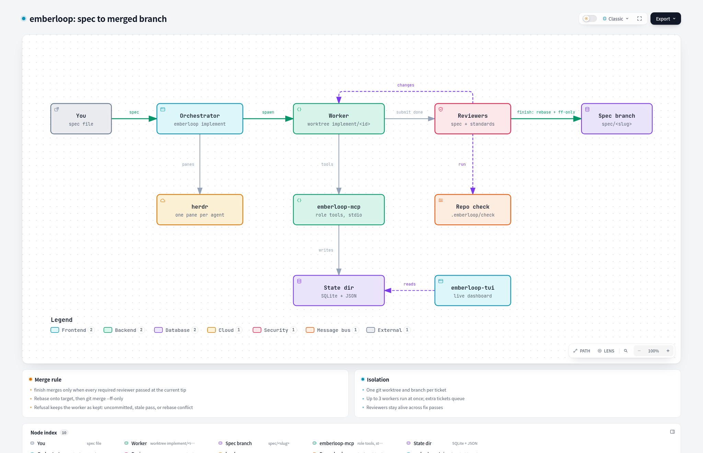
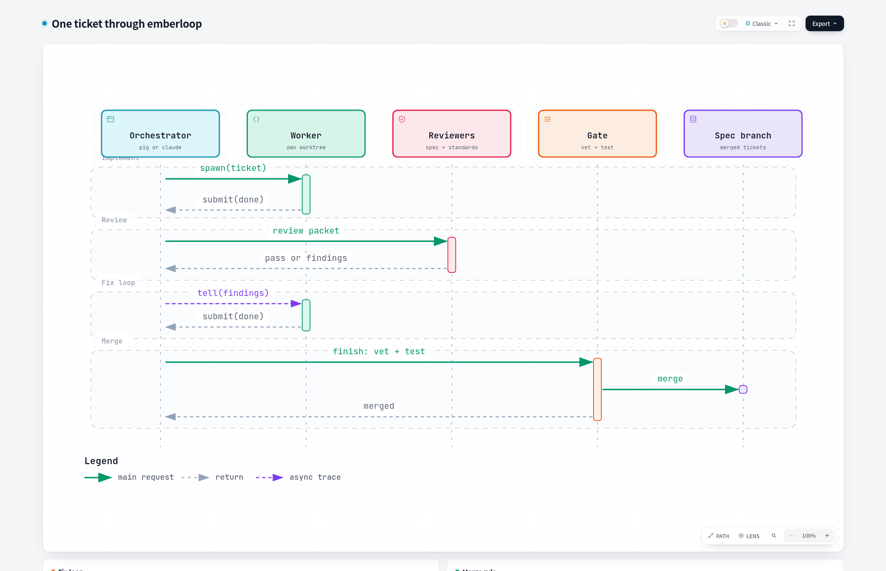
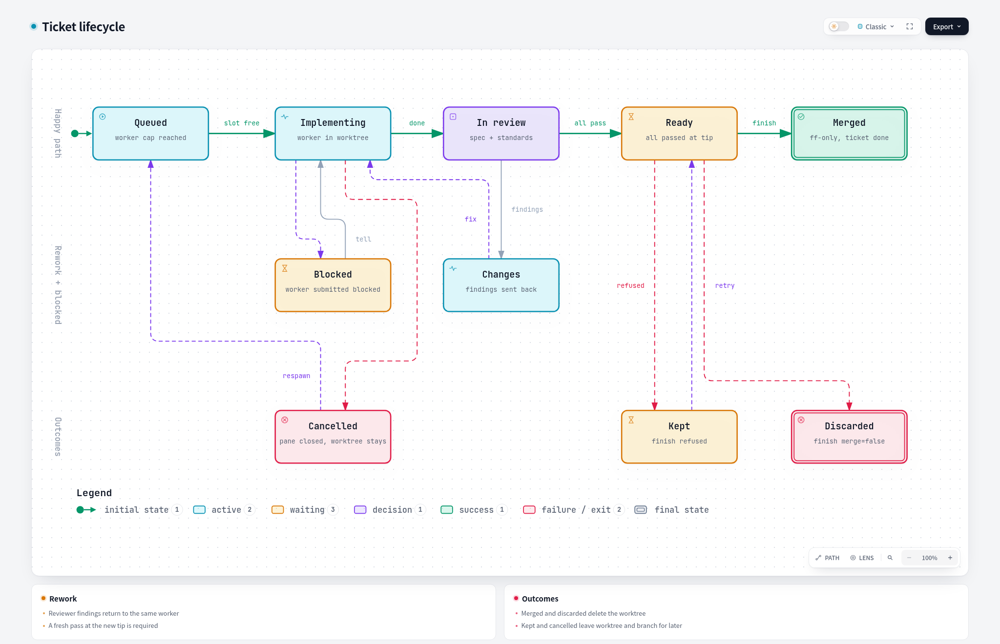
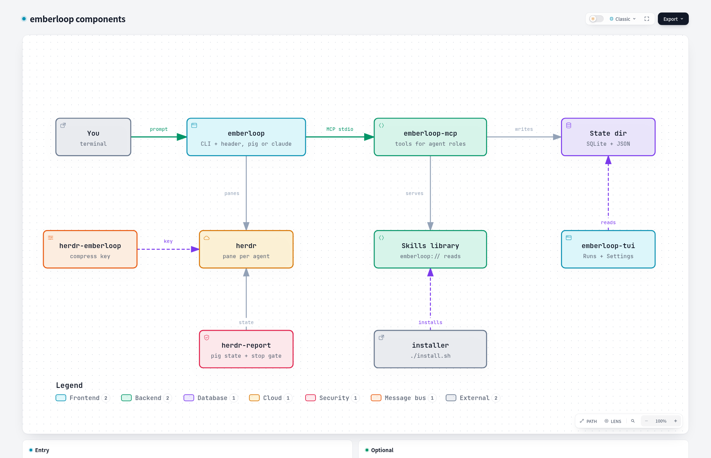

# emberloop

Emberloop is a browser UI and local Daemon that runs coding-agent sessions and deterministic implement/review Runs. A Run splits a spec into tickets, runs one worker per ticket in its own git worktree and branch, has persistent reviewers judge each worker, and merges a ticket only after every required reviewer has passed at the ticket's current tip.

<p align="center">
  <picture>
    <source media="(prefers-color-scheme: dark)" srcset="docs/architecture-dark.png">
    
  </picture>
</p>

## Install

You need Go 1.26 or newer, `git`, `curl` and `unzip` (bun needs it). On Debian or Ubuntu:

```bash
sudo apt-get install -y git curl unzip ripgrep bubblewrap
```

Install Go 1.26 from <https://go.dev/dl/> (the distro package is older). Run the installer from a clone:

```bash
git clone <this repository> emberloop
cd emberloop
./install.sh
```

On a terminal the installer shows a short menu. It asks for three optional parts and installs everything else without asking:

| Choice | What it adds |
|---|---|
| pig | the `el` entry in `~/.pig/agent/mcp.json`, the `pig-antigravity-auth` extension linked into `~/.pig/agent/extensions` |
| claude | the Claude Code CLI, installed with its official script when missing |
| graph | the code graph MCP (`codebase-memory-mcp`), served to reviewers and scouts |

Always installed: the `el` and `el-mcp` binaries in `~/.local/bin`, `~/.emberloop/settings.json`, and the skill library (fetched with `bunx`, so bun is required). The last two commands, `el deps` and `el skills install`, run on the plain terminal because `deps` can ask for a sudo password.

Put `~/.local/bin` on your `PATH`. Rerunning the installer changes nothing that is already in place.

Flags skip the UI:

```bash
./install.sh --yes                        # defaults: pig, claude, graph
./install.sh --yes --claude=false         # pig only
./install.sh --yes --graph=false          # no code graph
./install.sh --dry-run --yes              # print the steps, change nothing
./install.sh --bin-dir ~/bin              # another binary directory
```

## Use

Start the Daemon and open it in a browser (see [Emberloop](#emberloop)). Runs start from the UI: pick a spec, and the driver works every ticket to merged, parked or discarded.

Other commands:

| Command | Does |
|---|---|
| `el settings` | read and change role slots, models, tools and MCP servers |
| `el deps` | check and install system dependencies (python3, rg, git, bwrap, graph binary) |
| `el update` (`el install`) | rebuild the UI unless unchanged, rebuild the binaries from the checkout |
| `el logs` | print the prod Daemon journal |
| `el restart` | restart the prod Daemon |

## How a run works

The driver reads a spec, starts workers, and keeps every other ticket running while one waits. Each worker implements one ticket in `.el-worktrees/<ticket>` on branch `implement/<ticket>` and submits `done` or `blocked`. At most three tickets run at once by default (`max_tickets`); extra tickets wait until a slot frees. Subagents are uncapped: reviewers and scouts spawn freely.

Two reviewers, one for the spec and one for the repository's standards, keep their context across passes. They can run the repository's named checks from `.emberloop/check`. Findings go back to the same worker, and the loop repeats until every required reviewer passes.

A merge refuses unless every required reviewer passed at the current tip, so a stale pass does not count. It then rebases the worker branch onto the target and merges it with `git merge --ff-only`. A dirty worktree, a missing pass, or a rebase conflict keeps the worker alive instead of merging.

<p align="center">
  <picture>
    <source media="(prefers-color-scheme: dark)" srcset="docs/sequence-dark.png">
    
  </picture>
</p>

## Ticket lifecycle

<p align="center">
  <picture>
    <source media="(prefers-color-scheme: dark)" srcset="docs/lifecycle-dark.png">
    
  </picture>
</p>

## Components

<p align="center">
  <picture>
    <source media="(prefers-color-scheme: dark)" srcset="docs/components-dark.png">
    
  </picture>
</p>

| Directory | Contents |
|---|---|
| `emberloop-web/el/` | the el library behind the Daemon: tool roles, Run driver, session archive and usage, operator CLI |
| `emberloop-web/` | the browser UI and Daemon module: local Go Daemon plus embedded UI, loopback only |
| `pig-antigravity-auth/` | a pig extension that adds the `google-antigravity` model provider |
| `installer/` | the installer that `install.sh` runs |
| `scripts/` | live probes that need running agents |

## Emberloop

The browser UI runs on a local Daemon:

```bash
cd emberloop-web
go run ./cmd/emberloop-web
```

The Daemon prints its address; open it in a browser. Default bind is `127.0.0.1:0` (ephemeral port), override with `-addr`; `-state-dir` overrides the state directory. Loopback only: the Daemon refuses a non-loopback bind and rejects requests with a foreign `Host` or `Origin`. No authentication in this version.

On a remote server (VPS), keep the loopback bind and tunnel the port:

```bash
# on the server
go run ./cmd/emberloop-web -addr 127.0.0.1:8787
# on your machine
ssh -L 8787:127.0.0.1:8787 user@server   # then open http://127.0.0.1:8787
```

## Development

```bash
.emberloop/check
```

The check runs `go vet` and the tests for `emberloop-web/` (including `el/`) and `installer/`; live tests (`TestLive*`) are skipped. `AGENTS.md` files in each directory state the contract for that subtree; read the root file first.

## Files and environment

| Path | Purpose |
|---|---|
| `~/.local/bin` | installed binaries |
| `~/.emberloop/settings.json` | settings; `EL_SETTINGS` overrides the path |
| `~/.emberloop/skills` | the skill library behind `el://` addresses |
| `~/.pig/state/emberloop` | agent records, usage, archives |
| `.el-worktrees/` | one git worktree per ticket |

All environment variables use the `EL_` prefix.
