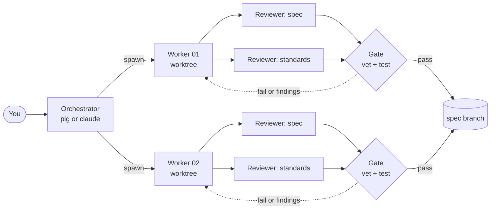
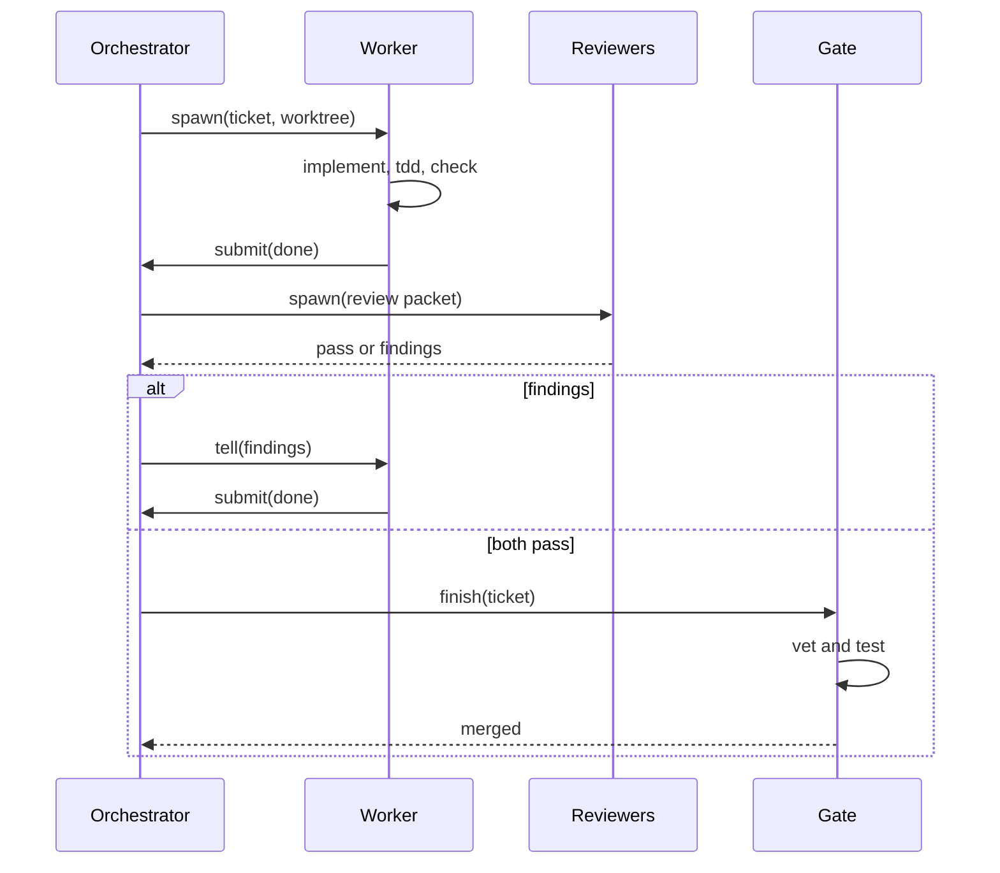
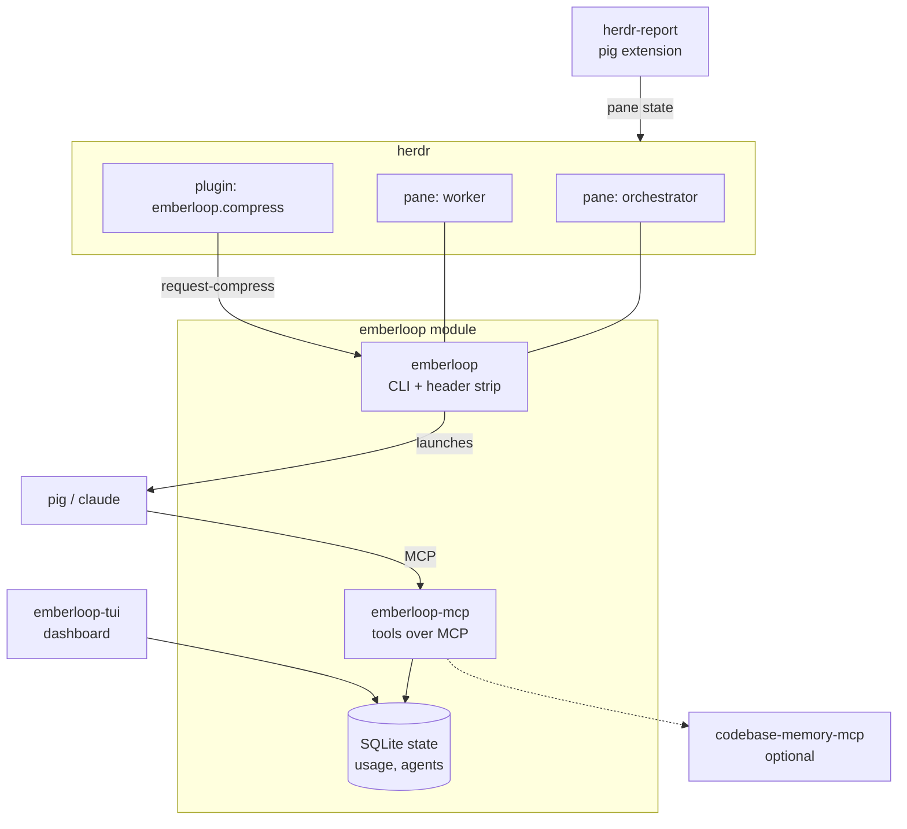

# emberloop

emberloop runs parallel implement-and-review loops for coding agents inside [herdr](https://github.com/ogulcancelik/herdr). An orchestrator session (pig or Claude Code) splits a spec into tickets, spawns one worker per ticket in its own git worktree, has two persistent reviewers judge each worker, and merges a ticket only after the vet-and-test gate and both reviewers pass.

Every agent runs in a herdr pane under a two-row status strip that shows model, context use, cost, running tool, queue and usage windows.

## Install

You need Go 1.26 or newer and `git`, `curl`. Run the installer from a clone:

```bash
git clone <this repository> emberloop
cd emberloop
./install.sh
```

The installer is a terminal UI. It asks for three optional parts and installs everything else without asking:

| Choice | What it adds |
|---|---|
| pig | the `emberloop` entry in `~/.pig/agent/mcp.json`, the `herdr-report` and `pig-antigravity-auth` extensions linked into `~/.pig/agent/extensions` |
| claude | the Claude Code CLI, installed with its official script when missing |
| memory | the code graph MCP (`codebase-memory-mcp`), served to reviewers and scouts |

Always installed: herdr (official script, when missing), the `emberloop`, `emberloop-mcp` and `emberloop-tui` binaries in `~/.local/bin`, the herdr compress plugin, the `prefix+shift+c` compress key in `~/.config/herdr/config.toml`, `~/.emberloop/settings.json`, and bun for the skill library. The last two commands, `emberloop deps` and `emberloop skills install`, run on the plain terminal because `deps` can ask for a sudo password.

Put `~/.local/bin` on your `PATH`. Rerunning the installer changes nothing that is already in place. A herdr config is copied to `config.toml.bak` before the first edit.

Flags skip the UI:

```bash
./install.sh --yes                        # defaults: pig, claude, memory
./install.sh --yes --claude=false         # pig only
./install.sh --yes --graph=false          # no code graph
./install.sh --dry-run --yes              # print the steps, change nothing
./install.sh --bin-dir ~/bin              # another binary directory
```

## Use

Start an orchestrator inside a herdr pane:

```bash
emberloop --pig          # or --claude
emberloop implement specs/my-feature.md
```

`implement` needs a herdr pane, because workers report back to their parent through notices typed into that pane. Without a pane it refuses before it creates anything.

Other commands:

| Command | Does |
|---|---|
| `emberloop settings` | read and change role slots, models, tools and MCP servers |
| `emberloop tui` | open the dashboard: runs, tickets, agents, costs, settings |
| `emberloop compress <pane>` | summarize the agent in a pane and restart it there |
| `emberloop deps` | check and install system dependencies (python3, rg, git, bwrap, graph binary) |
| `emberloop install` | rebuild the binaries from the checkout; refuses while agents are live |
| `emberloop context <session-id>` | print one session's context numbers |

`prefix+shift+c` in herdr compresses the focused pane. At a tool boundary it compresses at once; during a running tool call the request queues, and a second press forces it.

## How a run works



The orchestrator reads a spec, spawns workers, and waits for notices. Each worker implements one ticket in `.emberloop-worktrees/<ticket>` and submits `done` or `blocked`. Two reviewers, one for the spec and one for the repository's standards, keep their context across passes. A ticket merges only when the gate and both reviewers pass; findings go back to the same worker.



## Components



| Directory | Contents |
|---|---|
| `emberloop/` | the main Go module: sessions, spawn and grid, reviewers, gate and merge, tools, MCP server, state database |
| `emberloop-tui/` | the dashboard module |
| `herdr-emberloop/` | the herdr plugin with the compress action |
| `herdr-report/` | a pig extension that registers pig panes as herdr agents and enforces the stop gate |
| `pig-antigravity-auth/` | a pig extension that adds the `google-antigravity` model provider |
| `installer/` | the install TUI that `install.sh` runs |
| `scripts/` | live probes that need running agents |

## The input row and the queue

Messages for an agent queue in the wrapper: user messages first, then injected notices, in arrival order. A draft in the input box holds injected messages back so they never interleave with typing.

A draft clears itself only while messages wait behind it. After 10 seconds without a keystroke the wrapper clears the draft and delivers the queue. With an empty queue the draft stays. While messages wait, the strip shows `queued 3 messages · draft clears in 7s`, and the countdown resets on every keystroke.

## Development

```bash
.emberloop/check
```

The check runs `go vet` and the tests for `emberloop/`, `emberloop-tui/` and `installer/`; live tests (`TestLive*`) are skipped. `AGENTS.md` files in each directory state the contract for that subtree; read the root file first.

## Files and environment

| Path | Purpose |
|---|---|
| `~/.local/bin` | installed binaries |
| `~/.emberloop/settings.json` | settings; `EMBERLOOP_SETTINGS` overrides the path |
| `~/.emberloop/skills` | the skill library behind `emberloop://` addresses |
| `~/.pig/state/emberloop` | agent records, usage, archives |
| `.emberloop-worktrees/` | one git worktree per ticket |

All environment variables use the `EMBERLOOP_` prefix.
